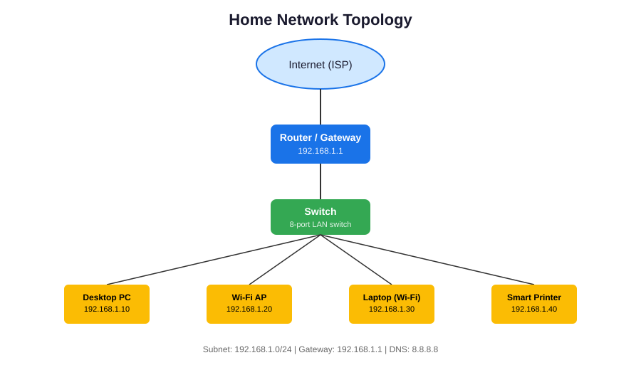

# Home Network Topology Documentation

## Overview
This project documents the layout, devices, and IP addressing scheme of a home/school network. It was completed as part of the **Beginner — Foundations** track (Core Networking) coursework at Kiriri Women's University of Science and Technology, Dept. of Computer Science & IT.

## Network Diagram

The network consists of:
- One **Router/Gateway** connecting the local network to the Internet via the ISP.
- One **Switch** providing wired LAN connectivity to internal devices.
- Multiple **end devices**: a desktop PC, a Wi-Fi access point serving wireless clients, a laptop, and a networked printer.

## IP Addressing Table

| Device            | Role                     | IP Address      | Subnet Mask     | Connection Type |
|-------------------|--------------------------|------------------|------------------|-----------------|
| Router/Gateway     | Internet gateway, DHCP server | 192.168.1.1    | 255.255.255.0    | WAN + LAN       |
| Switch             | Layer 2 wired distribution | N/A (unmanaged) | N/A              | Wired (uplink)  |
| Desktop PC          | End-user workstation     | 192.168.1.10     | 255.255.255.0    | Wired (Ethernet)|
| Wi-Fi Access Point  | Wireless connectivity    | 192.168.1.20     | 255.255.255.0    | Wired uplink, wireless downlink |
| Laptop              | End-user workstation (mobile) | 192.168.1.30 | 255.255.255.0    | Wireless (Wi-Fi)|
| Smart Printer        | Shared network printer  | 192.168.1.40     | 255.255.255.0    | Wireless (Wi-Fi)|

**Network Subnet:** `192.168.1.0/24`
**Default Gateway:** `192.168.1.1`
**DNS Server:** `8.8.8.8` (Google Public DNS)

## Device Roles Explained

### Router/Gateway
Sits at the edge of the network, connecting the internal LAN to the ISP's internet connection. It performs Network Address Translation (NAT), assigns IP addresses via DHCP, and acts as the default gateway for all internal devices.

### Switch
Operates at Layer 2 and provides multiple wired ports so several devices can connect to the LAN simultaneously. It forwards traffic based on MAC addresses and does not perform routing.

### Desktop PC
A stationary end-user device connected via Ethernet cable for a stable, low-latency connection — commonly used for tasks requiring consistent bandwidth (e.g. video calls, large downloads).

### Wi-Fi Access Point
Bridges wired and wireless networks, broadcasting an SSID so wireless clients (laptop, phones, etc.) can join the LAN without a physical cable.

### Laptop
A mobile end-user device connected wirelessly, allowing flexibility to move around the home/school while staying on the network.

### Smart Printer
A shared peripheral device on the network, allowing any authorized device on the LAN to send print jobs to it remotely.

## How to Reproduce This Documentation
1. Identify every device connected to your home/school network (check your router's admin panel, usually at `192.168.1.1` or `192.168.0.1`).
2. Note each device's IP address, connection type (wired/wireless), and role.
3. Draw the topology (physical layout) using a diagramming tool (draw.io, Lucidchart, or hand-drawn + scanned).
4. Compile the IP table and role descriptions into a README, as shown above.

## Tools Used
- Diagram created with SVG (vector graphic)
- Markdown for documentation
- Router admin panel for device/IP discovery

## Author
[Your Name] — Kiriri Women's University of Science and Technology, Dept. of Computer Science & IT
